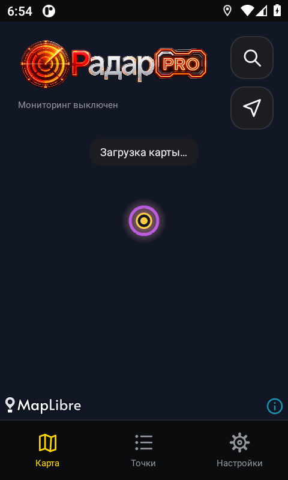
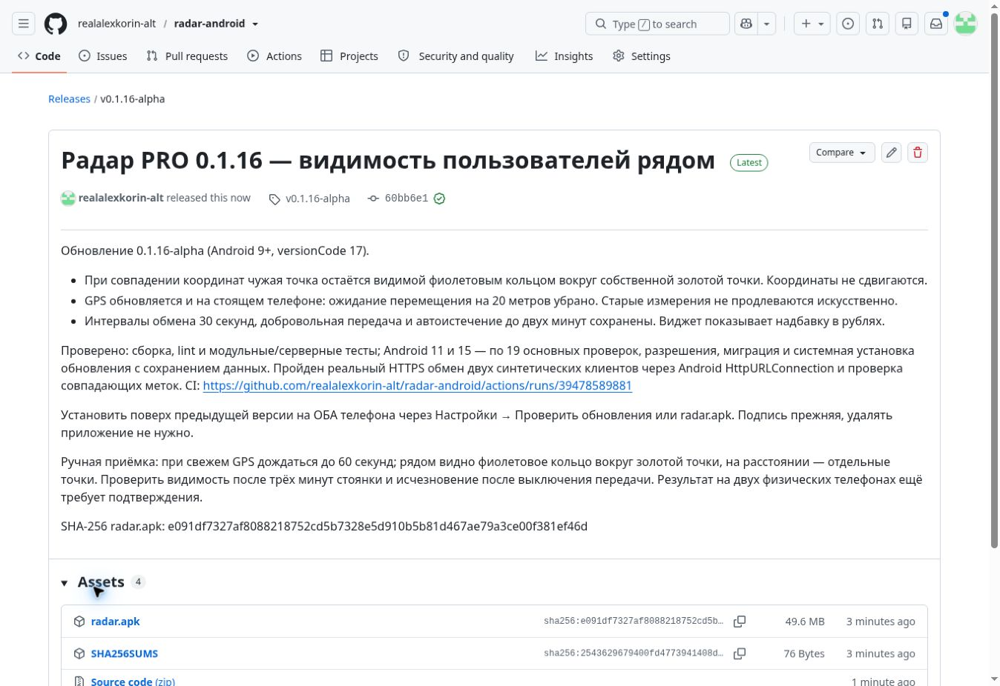

# 0.1.16 — видимость пользователей рядом

## Исправления

* При совпадении или близости точек на экране у чужой геопозиции появляется более широкое фиолетовое кольцо. Золотая собственная точка остаётся в центре; координаты меток не сдвигаются.
* Подписки на GPS сохраняют интервал 15 секунд, но больше не требуют перемещения на 20 метров. Это позволяет получать свежие измерения на стоящем телефоне. Старые измерения по-прежнему не продлеваются искусственно.
* Частота публикации и опроса сервера остаётся 30 секунд. Передача выключена по умолчанию и требует работающего PRO, разрешений и свежего GPS. Автоистечение — до двух минут.
* Версия Android: versionCode 17, versionName 0.1.16-alpha. Установка поверх 0.1.15 с прежней подписью.

## Проверки

Реальный production HTTPS: две временные синтетические точки в узком участке океана успешно опубликованы, получены и удалены (PUT/GET/DELETE: HTTP 200). Чужие реальные координаты не запрашивались.

Добавлены Android-инструментальные проверки:

* золотой центр и фиолетовое кольцо одновременно видимы при полностью совпадающих координатах на масштабе 12.3;
* два синтетических клиента через штатный Android HttpURLConnection, включая чтение и отзыв точки, с очисткой в finally;
* сохранены проверки отдельных меток, GPS-свежести, виджета в рублях, настроек, миграции и установки обновления.

CI [39478589881](https://github.com/realalexkorin-alt/radar-android/actions/runs/39478589881): все четыре задания прошли. Android 11 и 15: по 19 основных инструментальных проверок, отдельно разрешения и миграция; системный установщик обновил 17 → 18, точки и настройки сохранились. Реальный Android HTTPS и совпадающие метки прошли на обоих API. Снимок совпадающих меток просмотрен. Локальная offline-сборка заблокирована отсутствием AGP в кеше; локальные backend-тесты не запускались успешно без установки зависимостей. Источником проверки сборки служит CI.

## Ручная приёмка после установки на оба телефона

1. На обоих включить PRO и передачу геопозиции, открыть карту, дождаться свежего GPS и до 60 секунд обмена.
2. Рядом: золотая точка с дополнительным фиолетовым кольцом. Разойтись и приблизить карту: две отдельные точки.
3. Стоять на месте более трёх минут: чужая точка остаётся при свежих измерениях GPS.
4. Выключить передачу на одном телефоне: его чужая точка исчезает после следующего опроса; при обрыве сети — в пределах двух минут.

Эмуляторы и синтетический HTTP обмен не заменяют приёмку двух физических телефонов. Два найденных дефекта могут объяснять симптом, но первоначальная причина на устройствах пользователя без их телеметрии не установлена однозначно.

## Выпуск

Опубликован https://github.com/realalexkorin-alt/radar-android/releases/tag/v0.1.16-alpha как Latest, draft=false, prerelease=false. Тег: 60bb6e1c0179df386fcf60cb768d38d00480911b.

SHA-256 radar.apk: `e091df7327af8088218752cd5b7328e5d910b5b81d467ae79a3ce00f381ef46d`. Сертификат SHA-256: `7baf77afc2f4b5c570c9b08d6092f55ad3ec10a2d798649c846bf2a1429bbd89`. Подпись APK проверена apksigner, versionCode=17 подтверждён aapt.

