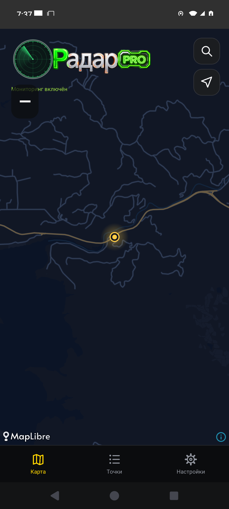

# 0.1.17 — экспериментальный логотип

Настройки → Дополнительно → «Экспериментальный»: выключен по умолчанию. Настройка сохраняется, переключение сразу меняет логотип карты без перезапуска. Исходный radar_logo.png не изменён. Выключение экспериментального режима восстанавливает исходную отрисовку побитно.

В экспериментальном режиме круг радара нарисован геометрией Canvas, надпись использует прежний PNG. При успешном запуске PRO круг, луч и первая буква становятся зелёными, PRO сохраняет существующую индикацию. Один оборот луча — четыре секунды. Мониторинг выключен: красно-оранжевый круг, неподвижный луч. Отрисовка ограничена 30 кадрами/с и прекращается в фоне, на скрытой карте, после выключения PRO или эксперимента. Анимация декоративная и не обозначает обнаруженные объекты.

Профили пользователей и «Друзья» остаются отдельным согласованным ТЗ; этот патч меняет оформление карты.

Проверка: профильный LogoSmokeTest на Android 11/15, сборка APK и lint. Сценарий проверяет исходный режим, включение настройки, сохранение после пересоздания, работу PRO, движение луча, остановку в фоне/на вкладке настроек и точное восстановление старого логотипа. CI [39562966593](https://github.com/realalexkorin-alt/radar-android/actions/runs/39562966593) успешно завершён на обоих API. Пройден один комплексный UI-сценарий на каждом: сохранение настройки, PRO, движение луча, фон/скрытая карта и побитный откат к PNG. Снимки нового оформления просмотрены. Полный набор серверных и геолокационных тестов повторно не запускался: их код не менялся.

Подписанный APK: versionCode 18, versionName 0.1.17-alpha; SHA-256 `e2fe5f6076dd5aed8ce18ed78706b035b7735b47859a79f6ab03b4909271d72e`. Сертификат SHA-256 `7baf77afc2f4b5c570c9b08d6092f55ad3ec10a2d798649c846bf2a1429bbd89`, прежняя подпись; apksigner verify и aapt пройдены.

Ручная приёмка: установить поверх предыдущей версии, включить «Экспериментальный», запустить PRO и оценить анимацию на физическом телефоне. Выключить переключатель и проверить привычный логотип.
