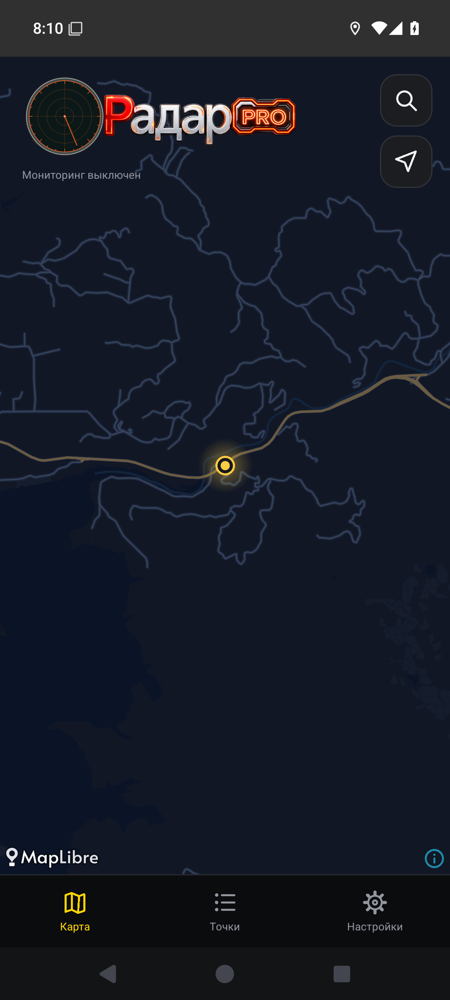

# 0.1.18 — плавный переход экспериментального логотипа

Луч больше не сбрасывается на −45° после выключения PRO. Скорость и цвет меняются за 500 мс: луч замедляется и останавливается на достигнутом угле; повторное включение разгоняет его с этой позиции. Быстрое повторное нажатие разворачивает переход из текущего состояния. Цвет круга, буквы «Р» и PRO меняется плавно. Угол сохраняется при паузе приложения и пересоздании экрана.

Экспериментальный режим по-прежнему выключен по умолчанию. Исходный PNG и обычный режим сохранены. Отрисовка приостанавливается вне карты и в фоне; после остановки завершающего перехода кадры больше не запрашиваются.

Проверки: два модульных сценария интегрирования угла, остановки/старта, быстрого разворота и паузы; профильный UI-сценарий на Android 11/15 с настоящей кнопкой PRO, промежуточным цветом, неизменностью угла после остановки и возвратом прежнего логотипа. Сборка и lint. Проверки кода приложения пройдены: Android 15 — задание 119111519015 прогона [39566990613](https://github.com/realalexkorin-alt/radar-android/actions/runs/39566990613); Android 11 — задание 119113383341 прогона [39567549402](https://github.com/realalexkorin-alt/radar-android/actions/runs/39567549402). Два модульных теста LogoMotionTest, сборка и lint прошли. В первом прогоне проверка Android 11 читала уровень цвета после асинхронного завершения перехода; тест перенесён в тот же UI-такт, что и нажатие. Производственный код и APK не менялись. Повторные Android 15 задания остановились до проверки перехода: системный Quickstep завис (ANR), его диалог перекрыл окно. Это подтверждено скриншотом; итоговый общий статус этих запусков не зелёный. Новых изменений приложения после успешного Android 15 прогона нет.

Профили и «Друзья» — следующая отдельная задача. Серверный код и обмен координатами этим выпуском не меняются.

APK взят из успешного Android 15 задания первого прогона: artifact 12330388037, ZIP SHA-256 f29370fcfc6468f2b0f03f33b45e48ce6d5c0044053eea516222be5f0db28c45. После него изменялся только UI-тест. SHA-256 подписанного radar.apk: `3cbad6816a1fcf3170d732fdf371031a16f970ed31147a63fe14188515437744`. apksigner verify пройден; сертификат прежний: `7baf77afc2f4b5c570c9b08d6092f55ad3ec10a2d798649c846bf2a1429bbd89`. aapt: versionCode 19, versionName 0.1.18-alpha.

Ручная приёмка: включить экспериментальный режим и PRO; выключить PRO на произвольном угле; проверить замедление и смену цвета, затем включить снова. Проверить быстрое повторное нажатие и возврат из фона.
