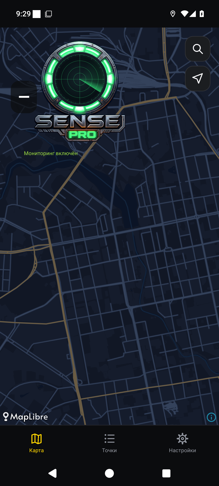

# 0.1.19 — SENSE PRO в экспериментальном режиме

Исходный PNG SENSE PRO сохранён в assets/sense_pro.png. Слои Canvas: неподвижный корпус и надпись SENSE из PNG; маска только голубых световых элементов; четыре крупных фрагмента металлической S; векторный локатор; отдельная маска подсветки вставки PRO, не затрагивающая её металлическую рамку. Текстуры декодируются с уменьшением вдвое под экранную плотность и только при включении экспериментального режима.

Центральная область круга — единственная кнопка. Надпись PRO не обрабатывает нажатия. Кнопка вызывает существующий toggleMonitor: мониторинг запускается немедленно, без второго сервиса или повторного звука. Виджет выключается тем же существующим путём.

Запуск: 0–1 с нажатие S и переход подсветки; 1–3 с четыре фрагмента уходят к внутреннему краю и исчезают; 2,5–4 с проявляется локатор; 4–5 с разгоняется луч. Фрагменты ограничены внутренним кругом. Остановка — обратная трансформация за 1,5 с. Быстрые повторные нажатия разворачивают текущую фазу, угол луча интегрируется без сбросов.

PRO отражает фактический MonitorService.running и меняет цвет за 500 мс независимо от пятисекундной механики. При отсутствии успешного старта зелёное состояние не устанавливается. Возврат на карту и пересоздание экрана сразу показывают текущее состояние сервиса, без нового пятисекундного старта. Угол сохраняется; кадровых циклов в фоне нет.

Настройки → Дополнительно → «Экспериментальный» по умолчанию выключено. Выключение возвращает прежний логотип и его PRO-кнопку. Сохранённое включённое значение прежней экспериментальной настройки показывает новый вариант SENSE. Сервер и геолокация не меняются.

Проверки: SenseMotionTest (тайминги, разворот, фон, неуспешное включение), SenseSmokeTest (нажатия центральной S, неактивный PRO, фактический запуск/остановка сервиса, кадры фаз, неподвижная надпись SENSE, возврат из фона/пересоздание, быстрое повторное нажатие, сохранение настройки, точный возврат прежнего логотипа); LogoSmokeTest (обычная PRO-кнопка). API 30/35, сборка и lint. CI [39576964317](https://github.com/realalexkorin-alt/radar-android/actions/runs/39576964317): оба задания прошли. На каждом API прошли четыре модульных сценария SenseMotionTest и два комплексных UI-сценария SenseSmokeTest/LogoSmokeTest, сборка и lint. Просмотрены фиксированные фазы механизма и реальный экран приложения. Полный набор независимых серверных тестов повторно не запускался. В тестовом эмуляторе перед запуском закрывается системный launcher3, который ранее перекрывал приложение собственным ANR-диалогом.

Команды быстрого старта/остановки передаются в тот же MonitorService; stopSelf(startId) позволяет последнему отложенному старту победить предыдущую остановку. Ожидающий foreground-запуск не уничтожается до вызова startForeground, что исключает системный таймаут Android. Проверяются два/три нажатия в одном UI-такте. Виджет сохраняет прежнюю логику и позицию; новый заголовок немного сдвинут вправо, чтобы не пересекаться с его исходной позицией.

Перед сборкой сверяется SHA-256 ресурса SENSE: `8e91f4ad3ba234dcb5f794a9a5198121bb1ce93dfade622d389960f5e381a0dd`. При ошибке чтения включается обычный логотип. Для веток логотипа добавлена отмена устаревшего CI-прогона при новом коммите.

## Выпуск и доказательства

APK: versionCode 20, versionName 0.1.19-alpha. SHA-256 `3cf91a82c36376bbf9a0e7f2a870a03269289cafa9d7a07be099fd197ff7c694`; сертификат прежний `7baf77afc2f4b5c570c9b08d6092f55ad3ec10a2d798649c846bf2a1429bbd89`. apksigner verify и aapt пройдены. CI artifact 12334508684, SHA-256 ZIP `78b52314c367c19d42849d78644918acca9c3267134db2abaa18238ad6615353` проверен перед подписью.

Фиксированные фазы получены тем же Canvas-рендерером без зависимости от задержек захвата экрана; это статические кадры, не запись времени анимации.

Ручная приёмка: установить обновление поверх прежней версии, включить «Экспериментальный», нажать центральную S. Проверить пятисекундную трансформацию, обратную сборку за 1,5 секунды, быстрые повторные нажатия и возврат из фона. Оценить плавность на физическом телефоне. При выключении эксперимента проверить прежний логотип и PRO-кнопку.
